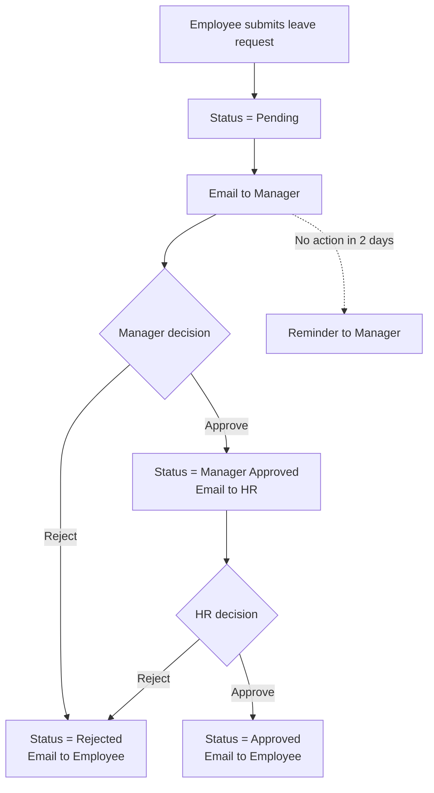

# Experiment 13: Building Approval-Based Workflow Automation in a Zoho Creator Application

## 1. Aim

To build an approval-based workflow in Zoho Creator for leave requests, with automatic notifications, status updates, and an audit trail.

## 2. Objectives

- Model an approval process (submit, review, approve/reject).
- Configure workflow triggers and actions.
- Send automatic email notifications.
- Update status and record approver comments.
- Test the complete flow with different users.

## 3. Requirements

| Item | Details |
|---|---|
| Account | Zoho Creator account |
| Application | **Business Hub** from Experiments 11 and 12 (Employee and Leave Request forms) |
| Test users | At least 3 email addresses you can access: an employee, a manager, and HR (can be your own aliases or invited test users) |
| Browser | Chrome, Edge, or Firefox |

> Workflow menus, approval features, and plan availability can change. Zoho Creator offers a dedicated **approval** capability in its workflow tools; if it is unavailable on your plan, Part C shows how to build the same behavior manually with form fields and Deluge. Check the current Zoho documentation.

## 4. Theory

### 4.1 Approval Workflow

An approval workflow routes a record through one or more approvers, who accept or reject it. Key elements:

| Element | Description |
|---|---|
| Trigger | Event starting the process (form submit) |
| Approver(s) | Person or role who decides (manager, HR) |
| Levels | Single or multi-level (sequential or parallel) |
| Actions | On approval, on rejection, on delay/escalation |
| Notifications | Emails or in-app messages |
| Audit trail | Who approved or rejected, when, and comments |

### 4.2 Workflow Events in Zoho Creator

| Event | Meaning |
|---|---|
| Form workflow: On create / On edit / On validate / On success | Run when records are added or edited |
| Schedule | Run on a date/time or recurring basis |
| Approval | Run when approval steps complete |
| Payment, Custom function triggers | Others as supported |

### 4.3 Process Design



## 5. Procedure

### Part A: Prepare the Forms

1. Open the **Leave Request** form in edit mode.
2. Make sure it has these fields (add any that are missing):

| Field | Type | Notes |
|---|---|---|
| Employee | Lookup (Employee) | |
| Employee Email | Email | Can be auto-filled from the Employee lookup |
| Manager Email | Email | Set from the employee record or entered by admin |
| HR Email | Email | Default value (e.g., hr@yourcompany.com) |
| Leave Type, From Date, To Date, Number of Days, Reason | As before | |
| Status | Dropdown | Pending, Manager Approved, Approved, Rejected |
| Manager Comments | Multi Line | Optional |
| HR Comments | Multi Line | Optional |
| Decided On | Date-Time | Optional |

3. Add **Manager Email** to the **Employee** form so each employee has an assigned manager.
4. Add a workflow **On user input** of the Employee lookup in Leave Request to fill email fields:

```
emp = Employee[ID == input.Employee];
input.Employee_Email = emp.Email;
input.Manager_Email = emp.Manager_Email;
```

> Use your own field link names. If a lookup returns a record collection, fetch with `Employee[ID == input.Employee]` and read fields from it.

### Part B: Set the Initial Status on Submit

1. Go to the form's **Workflow > On Create > On success**.
2. Add the script:

```
input.Status = "Pending";
```

(Alternatively set **Pending** as the default value of the Status dropdown.)

### Part C: Configure the Approval Process

**Option 1: Built-in Approval feature (if available)**

1. In the application, open **Workflow** and look for **Approvals** (or **Approval process**) for the **Leave Request** form.
2. Click **Create** and set:
   - Name: Leave Approval
   - Trigger: When a record is created
   - Approver level 1: **Manager Email** field value
   - Approver level 2: **HR Email** field value
3. Configure **On approval** and **On rejection** actions at each level:
   - Update **Status** (`Manager Approved` after level 1, `Approved` after level 2, `Rejected` on any rejection)
   - Send notification emails
4. Optionally set **reminders** and **escalation** if the option exists.
5. Save and enable the approval process.

**Option 2: Manual approval using fields, reports, and Deluge**

1. Create a report **Manager_Approvals** on Leave Request filtered by `Status = "Pending"`.
2. Add **custom actions (buttons)** to the report (Report > Customize > Custom actions or Action menu) named **Approve** and **Reject**, each running a Deluge function on selected records:

*Approve (manager):*

```
// Function: managerApprove(Leave_Request leave)
leave.Status = "Manager Approved";
leave.Decided_On = zoho.currenttime;

sendmail
[
    from: zoho.adminuserid
    to: leave.HR_Email
    subject: "Leave request awaiting HR approval"
    message: "A leave request for " + leave.Employee.Full_Name + " from " + leave.From_Date + " to " + leave.To_Date + " has been approved by the manager and needs your review."
]
```

*Reject (manager):*

```
leave.Status = "Rejected";
leave.Decided_On = zoho.currenttime;

sendmail
[
    from: zoho.adminuserid
    to: leave.Employee_Email
    subject: "Leave request rejected"
    message: "Your leave request from " + leave.From_Date + " to " + leave.To_Date + " was rejected. Comments: " + ifnull(leave.Manager_Comments, "None")
]
```

3. Create a second report **HR_Approvals** filtered by `Status = "Manager Approved"` with **HR Approve** and **HR Reject** actions that set `Approved` or `Rejected` and email the employee.
4. Use profiles from Experiment 11 so managers see only **Manager_Approvals** and HR sees only **HR_Approvals**.

> Function parameters, record references, and the exact email syntax depend on your form link names and Zoho Creator's current Deluge editor. Use the editor's autocomplete and error hints to adjust.

### Part D: Notify Manager on Submission

1. In the form's **On Create > On success** workflow, add after setting status:

```
sendmail
[
    from: zoho.adminuserid
    to: input.Manager_Email
    subject: "New leave request from " + input.Employee.Full_Name
    message: "Leave type: " + input.Leave_Type + "<br>From: " + input.From_Date + "<br>To: " + input.To_Date + "<br>Reason: " + input.Reason + "<br>Please review the request in Business Hub."
]
```

2. Add a confirmation email to the employee:

```
sendmail
[
    from: zoho.adminuserid
    to: input.Employee_Email
    subject: "Leave request submitted"
    message: "Your leave request has been submitted and is pending approval."
]
```

### Part E: Final Approval Notification

If you use Option 1, configure the email action in the final approval step. If you use Option 2, the HR approve function sends:

```
leave.Status = "Approved";
leave.Decided_On = zoho.currenttime;

sendmail
[
    from: zoho.adminuserid
    to: leave.Employee_Email
    subject: "Leave request approved"
    message: "Your leave request from " + leave.From_Date + " to " + leave.To_Date + " has been approved."
]
```

### Part F: Reminder for Pending Requests (Optional Schedule)

1. Create a **Schedule** (Workflow > Schedules) running daily on the Leave Request form with criteria `Status == "Pending"` and `Added_Time` older than 2 days.
2. Add an action that emails the manager a reminder:

```
for each leave in Leave_Request[Status == "Pending" && Added_Time < zoho.currenttime.subDay(2)]
{
    sendmail
    [
        from: zoho.adminuserid
        to: leave.Manager_Email
        subject: "Reminder: leave request pending"
        message: "A leave request from " + leave.Employee.Full_Name + " is awaiting your decision."
    ]
}
```

> Replace `Added_Time` with the system field name available in your form (commonly `Added_Time`).

### Part G: Test the Workflow

Run these test cases and record the outcomes:

| Test | Steps | Expected Result |
|---|---|---|
| T1: Submit | Employee submits request | Status = Pending; manager and employee emails received |
| T2: Manager approves | Manager approves | Status = Manager Approved; HR email sent |
| T3: HR approves | HR approves | Status = Approved; employee email sent |
| T4: Manager rejects | Manager rejects with comments | Status = Rejected; employee email includes comments |
| T5: HR rejects | HR rejects | Status = Rejected; employee notified |
| T6: Unauthorized | Employee tries to open the approvals report | No access |
| T7: Reminder | Request pending for 2+ days | Reminder email sent |

Verify using the **Leave Request** report and the Zoho Creator **Audit/Logs** (Settings > Audit Trail or Workflow Logs) to see each action and who performed it.

## 6. Observations

| Test | Actual Result | Pass/Fail |
|---|---|---|
| T1 | | |
| T2 | | |
| T3 | | |
| T4 | | |
| T5 | | |
| T6 | | |
| T7 | | |

### Screenshots to Attach

- Approval process configuration or custom action scripts
- Notification emails received
- Report showing status changes
- Audit trail or workflow log

## 7. Result

An approval-based workflow with notifications, status updates, and role-based access was built and tested in Zoho Creator.

## 8. Conclusion

Workflow automation replaces email chains and manual follow-up with consistent, traceable processes. Clear status tracking, automated notifications, and role-based access make approvals faster and more transparent.

## 9. Best Practices

- Keep statuses few and unambiguous.
- Always notify the next actor and the requester.
- Record comments and timestamps for auditability.
- Plan escalation for stalled approvals.
- Test every path, including rejections and unauthorized access.
- Avoid hard-coding email addresses; store them in forms or settings.

## 10. Viva Questions

1. What is an approval workflow and what are its key elements?
2. How does a multi-level approval differ from a single-level approval?
3. What events can trigger a workflow in Zoho Creator?
4. How would you implement reminders and escalation?
5. Why is an audit trail important?
6. How do you restrict who can approve a request?
