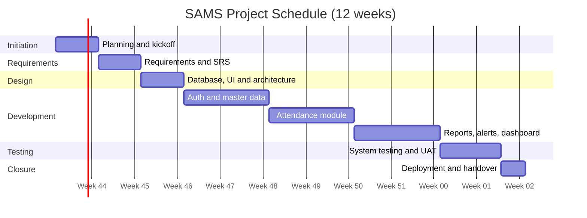

# Experiment 2: Preparation of a Software Project Plan Covering Scope, Timeline, and Team Roles for a Sample Application

## 1. Aim

To prepare a software project plan that defines scope, work breakdown, timeline, team roles, risks, and communication for a sample application.

## 2. Objectives

- Define project scope with inclusions and exclusions.
- Create a work breakdown structure (WBS) and schedule.
- Assign roles and responsibilities using a RACI matrix.
- Identify risks and mitigation actions.

## 3. Requirements

- Word processor or Markdown editor
- Optional: Gantt chart tool (GanttProject, Microsoft Project, Excel) or GitHub's built-in Mermaid rendering

## 4. Theory

A software project plan is a document that describes **what** will be built (scope), **when** (schedule), **who** will do it (roles), **how much** it will cost (effort/budget), and **what could go wrong** (risks). It is the baseline against which progress is tracked.

Key components: introduction, scope, deliverables, WBS, schedule, resources, risk management, quality plan, communication plan, and change control.

## 5. Sample Project: Student Attendance Management System (SAMS)

### 5.1 Project Overview

| Item | Details |
|---|---|
| Project name | Student Attendance Management System (SAMS) |
| Purpose | Digitize attendance marking, reporting, and notifications for a college |
| Users | Administrators, faculty, students, parents |
| Delivery approach | Agile (Scrum) with 2-week sprints |
| Duration | 12 weeks |

### 5.2 Scope

**In scope**

- User login with role-based access (admin, faculty, student)
- Class and subject management
- Daily attendance marking by faculty
- Attendance reports (student-wise, class-wise, date range)
- Low-attendance alerts by email/SMS
- Dashboard for administrators

**Out of scope**

- Biometric or face-recognition hardware integration
- Payroll and fee management
- Native mobile apps (responsive web only in version 1)

**Assumptions**

- College provides student and faculty master data in spreadsheet format.
- Cloud hosting will be available.
- Faculty are available for user acceptance testing in week 11.

**Constraints**

- Fixed 12-week deadline
- Fixed team of 5 members

### 5.3 Deliverables

| # | Deliverable | Due |
|---|---|---|
| D1 | Software Requirements Specification (SRS) | Week 2 |
| D2 | System design document and UI mockups | Week 3 |
| D3 | Working modules (login, master data, attendance) | Week 7 |
| D4 | Reports and dashboard | Week 9 |
| D5 | Test report | Week 11 |
| D6 | Deployed application, user manual | Week 12 |

### 5.4 Work Breakdown Structure

```
1. Initiation
   1.1 Stakeholder meetings
   1.2 Project plan approval
2. Requirements
   2.1 Requirements gathering
   2.2 SRS preparation and sign-off
3. Design
   3.1 Database design
   3.2 UI/UX mockups
   3.3 Architecture design
4. Development
   4.1 Authentication and roles
   4.2 Master data management
   4.3 Attendance module
   4.4 Reports and alerts
   4.5 Dashboard
5. Testing
   5.1 Unit and integration testing
   5.2 System testing
   5.3 User acceptance testing
6. Deployment and Closure
   6.1 Deployment
   6.2 Training and documentation
   6.3 Project review
```

### 5.5 Timeline (Gantt Chart)



*Adjust the start date and durations to match your plan.*

### 5.6 Team Roles and Responsibilities

| Role | Responsibilities | Count |
|---|---|---|
| Project manager / Scrum master | Planning, tracking, risk management, communication | 1 |
| Business analyst | Requirements, SRS, user acceptance coordination | 1 |
| UI/UX designer | Mockups, usability | 1 (shared) |
| Developer | Front-end, back-end, database | 2 |
| Tester | Test cases, execution, defect reporting | 1 |

### 5.7 RACI Matrix

R = Responsible, A = Accountable, C = Consulted, I = Informed

| Activity | PM | BA | Designer | Developer | Tester | Client |
|---|---|---|---|---|---|---|
| Project plan | A/R | C | I | I | I | C |
| Requirements and SRS | A | R | C | C | C | C |
| UI design | A | C | R | C | I | C |
| Development | A | C | C | R | I | I |
| Testing | A | C | I | C | R | I |
| UAT | A | R | I | C | C | R |
| Deployment | A | I | I | R | C | I |

### 5.8 Effort Estimate (Illustrative)

| Phase | Effort (person-days) |
|---|---|
| Requirements | 8 |
| Design | 12 |
| Development | 70 |
| Testing | 20 |
| Deployment and documentation | 10 |
| Project management (overhead) | 12 |
| **Total** | **132** |

### 5.9 Risk Register

| ID | Risk | Probability | Impact | Mitigation |
|---|---|---|---|---|
| R1 | Requirements change late | Medium | High | Change control, sprint reviews |
| R2 | Key team member unavailable | Low | High | Cross-training, documentation |
| R3 | Poor data quality in master data | Medium | Medium | Data validation scripts, early import trial |
| R4 | Delay in faculty UAT participation | Medium | Medium | Schedule UAT slots in advance |
| R5 | Security issues (unauthorized access) | Low | High | Role-based access, security testing |

### 5.10 Communication Plan

| Communication | Frequency | Audience | Medium |
|---|---|---|---|
| Daily stand-up | Daily, 15 minutes | Team | Meeting/chat |
| Sprint review | Every 2 weeks | Team and client | Demo |
| Status report | Weekly | Client, management | Email |
| Retrospective | Every 2 weeks | Team | Meeting |

### 5.11 Change Control

1. Change request is raised in writing.
2. BA and PM assess impact on scope, time, and cost.
3. Client approves or rejects.
4. Approved changes update the plan and backlog.

## 6. Procedure

1. Choose a sample application (or use SAMS).
2. Define the scope: inclusions, exclusions, assumptions, and constraints.
3. List deliverables and break work down into a WBS.
4. Build the schedule and draw a Gantt chart.
5. Assign roles and prepare the RACI matrix.
6. Estimate effort and identify risks with mitigations.
7. Compile everything into the project plan document.

## 7. Observations

| Item | Your Entry |
|---|---|
| Application selected | |
| Project duration | |
| Team size | |
| Top three risks | |

## 8. Result

A project plan with scope, WBS, timeline, team roles, RACI, risks, and communication plan was prepared for the sample application.

## 9. Conclusion

A clear project plan sets expectations, enables tracking, and reduces the chance of schedule and scope problems. It should be reviewed and updated as the project progresses.

## 10. Viva Questions

1. What is the difference between scope and deliverables?
2. What is a WBS and why is it useful?
3. What does a RACI matrix show?
4. How do you handle change requests?
5. Name two techniques for estimating effort.
6. What is the critical path in a schedule?
